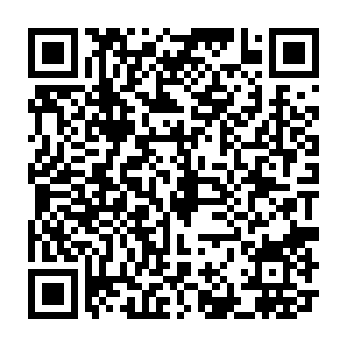

# One-time iPhone setup

[Open the TetherNest shortcut](https://www.icloud.com/shortcuts/d9444411a7cc4d6abbeb01ad9bff7124)

1. Scan the QR code using the iPhone camera and tap the link. Check the preview is named **TetherNest**, then tap **Add Shortcut**.
2. Open TetherNest in Shortcuts for editing. Open its **Bluetooth** trigger. Turn **Enabled** on and leave **Confirm Before Run** off. A clean import was observed to leave the trigger disabled: scanning alone does not enable it.
3. Confirm the trigger is **When any device is connected**, followed by **Personal Hotspot Off**, **Wait 3 seconds**, **Personal Hotspot On**. This can reset the hotspot when headphones or other Bluetooth devices connect too. Avoid multiple enabled copies.
4. Pair the iPhone with the PC in Windows Bluetooth settings. Join the phone hotspot once through Windows Wi-Fi so its profile is saved.
5. In the Windows widget, open **iPhone setup**, select that saved hotspot, confirm the setup checkbox and save.

The tested recent Shortcuts interface adds Automation from the action search area inside a shortcut. Older iOS versions may use a separate Automation editor and may not import the trigger. The clean QR import and locked-phone trigger were tested on an iPhone 17 Pro; the exact iOS build was not recorded. Do not infer support for every older phone from that test.

If testing an updated import, note that Replace produced duplicate entries during development. Inspect which copy's trigger is enabled. Do not leave multiple hotspot-reset automations enabled.

The Windows Connect button cycles Bluetooth globally. A previously paired phone must reconnect for the phone automation to fire. The shortcut does not instruct Windows to join Wi-Fi; TetherNest performs that separate step.
